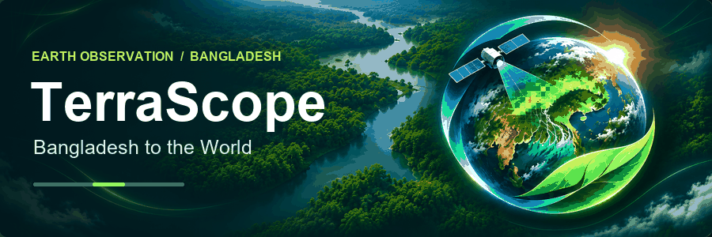

# TerraScope

Explore vegetation change in Bangladesh and compare it with selected study points around the world. TerraScope is an independent NASA Space Apps project that brings satellite imagery, measured vegetation indices, and climate context into one dashboard.

[**Open TerraScope**](https://terra-scope-liart.vercel.app/) · [**Sundarbans comparison**](https://terra-scope-liart.vercel.app/#sundarbans) · [**Methodology**](https://terra-scope-liart.vercel.app/#methodology)

## Explore the dashboard

| Feature | What you can see |
| --- | --- |
| Interactive map | View NASA imagery and locate the representative study points in Bangladesh, Assam, Chiang Mai, and Riyadh. |
| Vegetation trends | Compare MODIS NDVI and EVI from 2001–2024, review seasonal patterns, and check observation coverage and trend uncertainty. |
| Sundarbans comparison | Slide between January 2020 and January 2024 Sentinel-2 composites at 10 m. Switch to measured NDVI or NDVI change, inspect a pixel, or download GeoTIFFs. |
| MODIS long-term view | Explore the 250 m Sundarbans pilot comparison for 2001–2005 versus 2020–2024 using matching months. |
| Climate and explanations | Load NASA POWER climate context and read plain-language explanations of the results. |

## How to read the results

**NDVI** is a satellite measure of vegetation greenness. In the Sundarbans comparison, the **Before / after** tab shows the landscape in true color. Use **NDVI change** to see the measured difference and **Select pixel** to inspect both values at one location.

The Sundarbans maps cover pilot areas. The four study locations represent individual points. Use the coverage and quality panels to see where observations support a comparison. Estimates of forest area or tree counts require separate analysis.

## Run locally

Use Node.js 22.10+ and npm.

```sh
npm ci
npm run dev
```

Open [localhost:3000](http://localhost:3000). The repository includes measured MODIS observations and processed Sentinel-2 assets. For optional server settings, copy [the environment template](.env.example) to `.env.local`.

```sh
npm run lint
npm run typecheck
npm test
npm run build
```

Built with Next.js, React, TypeScript, MapLibre, and Recharts.

## Data and methods

- **NASA MODIS / AppEEARS** supplies point observations and the long-term Sundarbans pilot. [Measured data](docs/MEASURED_DATA.md) · [Import workflow](docs/MODIS_WORKFLOW.md) · [MODIS raster methods](docs/SUNDARBANS.md)
- **Copernicus Sentinel-2 / Earth Search** supplies the 10 m Sundarbans comparison. [Processing and coverage](docs/SENTINEL2.md) · [Source manifest](public/data/sentinel2/manifest.json)
- **NASA GIBS and NASA POWER** provide imagery and climate context. [GIBS](https://nasa-gibs.github.io/gibs-api-docs/) · [POWER](https://power.larc.nasa.gov/)
- **Trend analysis** documents quality filtering, missing observations, and uncertainty. [Statistical methodology](docs/STATISTICS.md)
